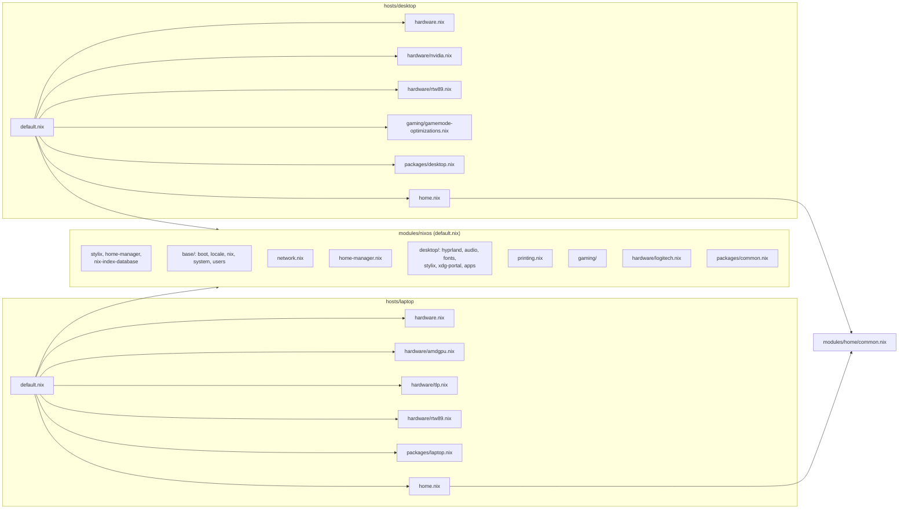

# Graphe des modules

## À retenir

- Tout ce qui est commun passe par `modules/nixos/default.nix`.
- Le matériel est importé explicitement par chaque host (`modules/nixos/hardware/`).
- Côté utilisateur, `modules/home/common.nix` importe tous les modules Home Manager partagés.
