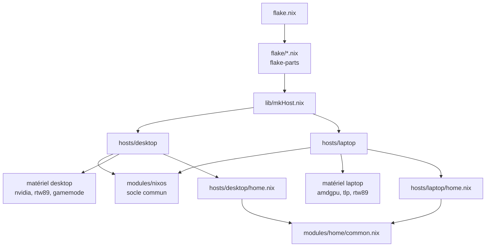

# Vue d'ensemble

La flake expose deux configurations NixOS, `desktop` et `laptop`, construites par la même fabrique
(`lib/mkHost.nix`). Chaque host importe le socle commun (`modules/nixos`) puis ajoute son matériel,
son utilisateur et ses modules propres.

## Principes

1. **Socle commun** (`modules/nixos`) : boot, Nix, locale, réseau, bureau, impression, jeux, paquets.
2. **Spécificités par machine** (`hosts/<host>`) : matériel, utilisateur, ports, services propres.
3. **Session utilisateur** : Home Manager, avec `modules/home/common.nix` partagé et un `home.nix`
   par host pour les différences.
4. **Contournements tracés** : chaque fix temporaire est inscrit dans `temp-fixes.toml`
   (voir [Fix temporaires](../reference/temp-fixes.md)).
