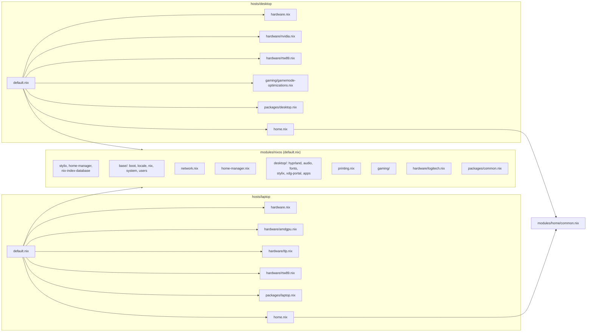

# Module graph

## Key points

- Everything shared goes through `modules/nixos/default.nix`.
- Hardware is imported explicitly by each host (`modules/nixos/hardware/`).
- On the user side, `modules/home/common.nix` imports every shared Home Manager module.
