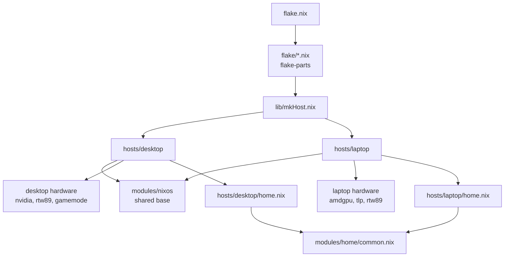

# Overview

The flake exposes two NixOS configurations, `desktop` and `laptop`, built by the same function
(`lib/mkHost.nix`). Each host imports the shared base (`modules/nixos`) and adds its hardware, its
user and its own modules.

## Principles

1. **Shared base** (`modules/nixos`): boot, Nix, locale, network, desktop, printing, gaming, packages.
2. **Per-machine specifics** (`hosts/<host>`): hardware, user, ports, own services.
3. **User session**: Home Manager, with a shared `modules/home/common.nix` and one `home.nix` per
   host for the differences.
4. **Tracked workarounds**: every temporary fix is recorded in `temp-fixes.toml`
   (see [Temporary fixes](../reference/temp-fixes.md)).
